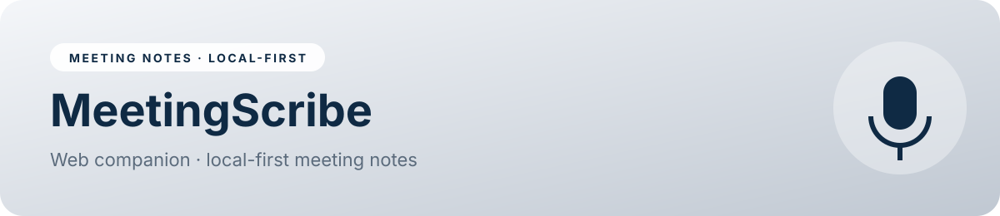

<p align="center"></p>

<p align="center">


</p>

<p align="center"><a href="https://naekitakadoportfolio.github.io/meetingscribe-web/"></a></p>

# MeetingScribe

MeetingScribe turns meetings into notes, decisions and action items. The desktop tray app records mic + system audio and transcribes **locally** (faster-whisper + Ollama). This web companion is where you browse, search and act on the results.

## ✨ Features
- **Dashboard:** upcoming meetings with reminders, recent notes and open action items
- **Upcoming:** add meetings, toggle reminders, and import events by pasting `.ics` calendar text
- **Meeting library:** full-text search across titles and transcripts, with tag filters and match snippets
- **Meeting detail:** speaker-turn transcript, summary, keywords, decisions, open questions and editable action items (owner, due date, done); copy notes to the clipboard
- **New notes:** paste any transcript to get an in-browser summary that extracts action items, decisions, questions and keywords, with no server involved
- **Action items board:** open vs done columns with an owner filter
- **Desktop app:** what the tray app does, its privacy model, and setup steps
- **Settings:** default owner, reminder lead time, auto-notes and JSON export

## 🧭 Try it
1. Open **Meeting library** and click a meeting to see the full notes
2. Paste your own transcript into **New notes** → *Generate notes* → *Save to library*
3. Tick items off on the **Action items** board

Live: **https://naekitakadoportfolio.github.io/meetingscribe-web/**

## 🏗 Architecture
| Layer | Implementation |
|---|---|
| Capture | Desktop tray app (Python): mic + system audio |
| Transcription | faster-whisper, running locally |
| Summaries | Ollama · Llama 3.1 8B, running locally |
| Calendar | Google Calendar `.ics` feed → reminders |
| Web companion | Static SPA; heuristic parser in `parse()`; `localStorage` |

## 📁 Project structure
```
meetingscribe-web/
├── index.html        # built app (served by GitHub Pages)
├── src/
│   ├── app.js        # views, state, logic
│   └── app.json      # app config: nav, theme, metadata
├── assets/banner.svg
├── README.md
└── LICENSE
```

## 🚀 Run locally
No dependencies needed. Open `index.html`, or:
```bash
python3 -m http.server 8000   # http://localhost:8000
```

## 🧩 Implementation notes
- `parse()` splits `Name: text` turns, then uses pattern rules to find action items ("I will…", "Action:", "by Friday"), decisions ("decided", "agreed") and questions
- Owners come from the speaker, or from "Action for X" / "X will"
- Keywords use term frequency with a stop-word list

## 🗺 Roadmap
- Sync notes from the desktop app's folder
- Speaker diarization labels
- Export to Notion / Google Docs

---
<p align="center"><sub>Built by <b>Nae Kitakado</b>, AI Automation Consultant · <a href="https://www.linkedin.com/in/nae-k-203194265">LinkedIn</a> · <a href="https://github.com/naekitakadoportfolio">GitHub</a> · open to retainer &amp; part-time consulting</sub></p>
